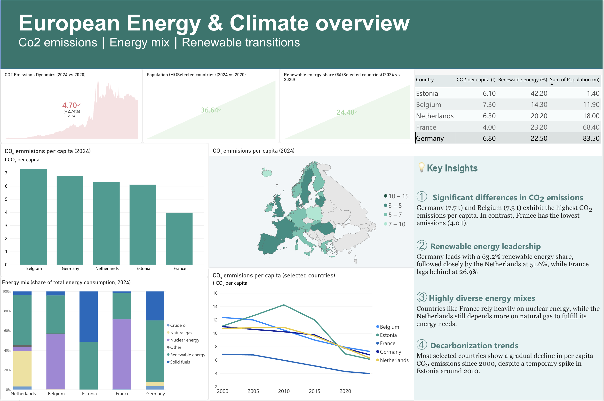

# European Energy & Climate Insights Dashboard (Power BI)

## Project Overview
An interactive **Power BI Dashboard** designed to analyze and visualize carbon dioxide (CO₂) emissions per capita alongside renewable energy consumption trends across selected European nations (Estonia, Belgium, Germany, France, and the Netherlands) from 2000 to 2026. 

This project bridges the gap between industrial ecology domain expertise and data engineering, converting raw environmental datasets into actionable business and regulatory insights aligned with EU ESG reporting frameworks (CSRD/ESRS).

---

## Dashboard Preview

---

## 💡 Key Insights & Analytics
1. **Carbon Footprint Variance:** Belgium (7.30 t) and Germany (6.80 t) exhibit the highest CO₂ emissions per capita within the selected group. In contrast, France demonstrates the lowest carbon footprint at 4.00 t per capita due to its structural energy mix.
2. **Sustainability Leadership:** Estonia is the absolute leader in sustainability, driving a remarkable **42.2% renewable energy share**, significantly outperforming Belgium (14.3%) and Germany (22.5%).
3. **Energy Mix Heterogeneity:** Energy structures vary drastically: France relies heavily on nuclear power infrastructure, the Netherlands depends primarily on natural gas and crude oil commodities, while Germany still shows a solid consumption of solid fuels.
4. **Decarbonization Trends:** Most selected European nations demonstrate a gradual, long-term decline in per capita CO₂ emissions since 2000, confirming the structural transition toward cleaner energy sources despite localized historical fluctuations.

---

## 🛠️ Data Engineering & Methodology
* **Data Sources:** European environmental open-data repositories (2000–2026).
* **ETL Process:** Data cleaning, attribute renaming, and type casting performed using **Power Query**.
* **Data Modeling:** Developed a star schema framework with dedicated dimension and fact indicators.
* **Tech Stack:** Power BI Desktop, DAX, Power Query.

---

## Author
* **Name:** Jevgenia Fjodorova
* **Role:** Sustainability & Environmental Data Analyst
* **Credentials:** MSc in Industrial Ecology (TalTech, Cum Laude)
* **LinkedIn:** www.linkedin.com/in/jevgenia-fjodorova

